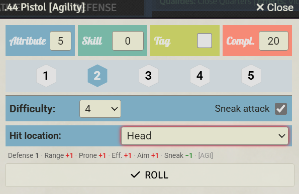
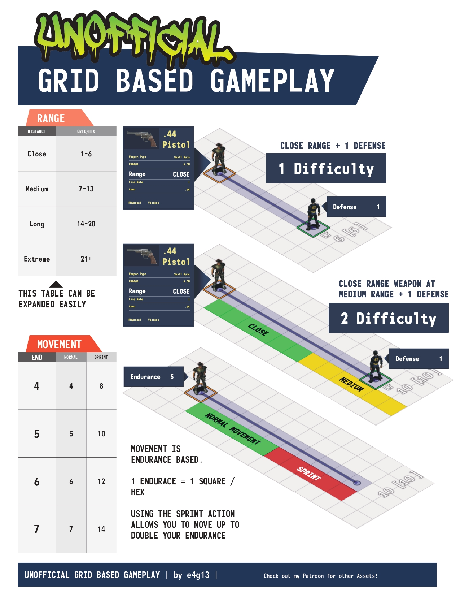
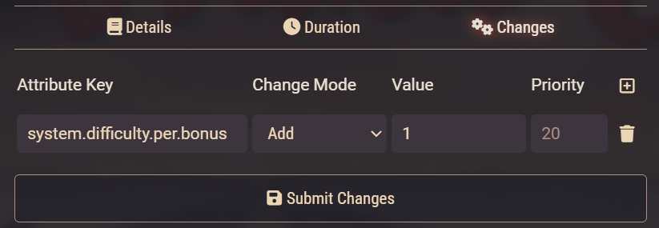
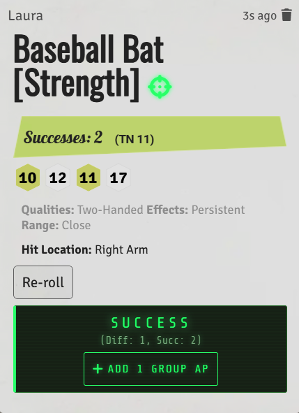
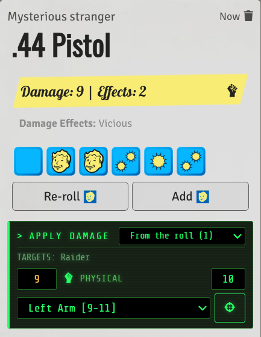
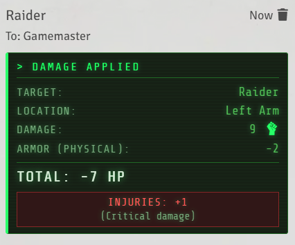
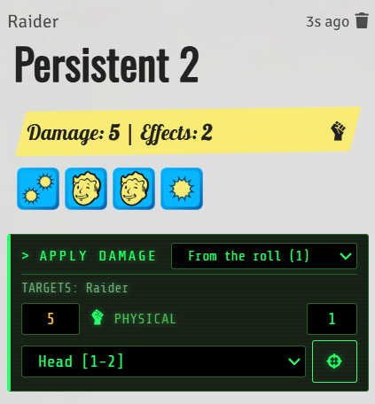
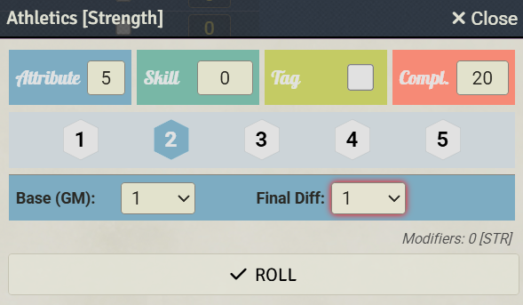
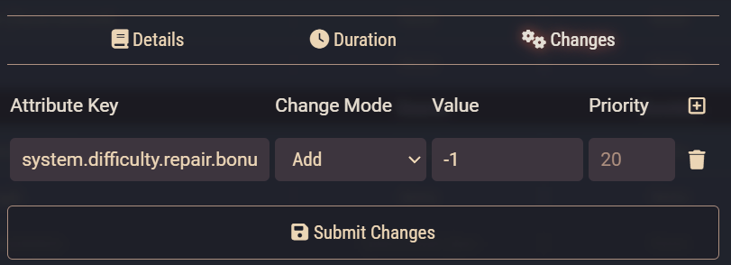

# Fallout Automation

**English** · [Русский](#русский)

Automation for the **Fallout 2d20** system on **Foundry VTT v13**. It links attack rolls to damage rolls, calculates roll difficulty and shows the success verdict, and applies damage with armor. The interface is available in English and Russian.

This module started as "Midi-QOL for Fallout", and it may grow into other kinds of automation later. For now it helps with automating roll handling.

> Early release. It was built around one table's rules and workflow, so please report anything that looks wrong in [Issues](../../issues).

## Requirements

- Foundry VTT **v13** (v14 has not been tested, but may work)
- Game system **Fallout** 11.16 or newer (tested on 11.16.6)
- Module **socketlib** (required)
- Recommended: **Convenient Effects** (8.x), **Times Up** (removes effects when their duration ends), **Tagger**
- Compatible with Argon HUD: [enhancedcombathud-fallout](https://github.com/TheGhostlyCola/enhancedcombathud-fallout)

## Installation

In Foundry: **Add-on Modules → Install Module**, paste this manifest URL and press Install:

```
https://github.com/Super-zapper/fallout-automation/releases/latest/download/module.json
```

Then enable the module in your world (it also needs socketlib).

---

## Attack roll

The attack roll dialog is extended: manual difficulty selection, a Sneak Attack checkbox, a hit location selector and difficulty modifiers.



After the roll, the number of successes is compared with the difficulty set in this dialog to decide whether the attack succeeded. The difficulty is calculated automatically and set as the default, but you can change it by hand if you like. Many factors are taken into account:

1. **Target's Defense.** Simple.

2. **Target's range.** This one is more complicated. For convenient play on a grid, I used homebrew range rules, as shown in the picture below. When you target a token, a notification shows the distance to the target in squares and the matching range. Penalties for attacking outside the ideal range are calculated automatically.

   

   The penalty for fighting at point-blank range is also taken into account, but it is ignored for weapons with the close quarters quality (like pistols). If you try to attack with a melee weapon at a target that is not adjacent, a warning is shown, but you can still roll.

3. **Prone target.** If the target is Prone and within close range, the attack difficulty is reduced by 1. Beyond close range it is increased by 1.

4. **Sneak attack.** If the "Sneak Attack" checkbox is ticked in the attack roll dialog, the difficulty is reduced by 1.

5. **Hit location.** If any hit location other than random is selected, the difficulty is increased by 1. The exception is an attacker with a Pip-Boy in their inventory.

6. **Active effects.** Any active effects on the attacker (for example from chems) with a `system.difficulty.x.bonus` key are also taken into account, as in the screenshot below. A positive value makes the roll harder, a negative one makes it easier. Full list of attribute keys:

   ```
   system.difficulty.str.bonus
   system.difficulty.per.bonus
   system.difficulty.end.bonus
   system.difficulty.cha.bonus
   system.difficulty.int.bonus
   system.difficulty.agi.bonus
   system.difficulty.luc.bonus
   ```

   

The result of the attack roll is shown at the bottom of the message. If the number of successes exceeds the difficulty, a button appears to add AP to the GM or to the players, depending on who made the roll.



Target selection for weapons with the Blast quality has also been reworked. Before the roll dialog appears, you are first asked to place a template to select the targets.

## Damage roll

When you roll damage, an extended message appears in chat, as in the screenshot below.



1. The module tries to determine the targets from the attack roll made earlier. To set a target by hand, target the token you need and switch "Targets" from "From roll" to "Current selection".
2. The damage total is shown next to its type and can be changed by hand if needed. With the Vicious damage effect, every effect rolled on the dice adds +1 to this total.
3. The body part that was hit is also taken from the attack roll, but you can change it by hand.
4. If the attack roll was a Sneak Attack, the damage gains the Vicious quality, or +2 CD if it already had it.

When you are happy with all the values, press the crosshair button to deal the damage. A message with the damage calculation then appears, as in the screenshot below.



The module takes the damage dealt, determines the body part it hit, determines the resistance to this damage type on that body part, and subtracts it from the damage. If the target is immune to this damage type, no damage is dealt. If a weapon deals more than one damage type (plasma), the lowest resistance value is used. Radiation damage is applied separately, after the rest of the damage.

If the damage has the Stun quality, then when at least one effect is rolled on the damage dice, the target gets the Stunned effect.

If the damage has the Persistent quality, then when at least one effect is rolled on the damage dice, the target gets the Persistent effect. At the end of the target's turn it takes damage from this weapon again, as in the screenshot below. For the Persistent effect to be removed automatically, you need the Times Up module.



The target can get injuries when taking damage, in several circumstances. If the damage is 5 or more, the target gets an injury on the corresponding body part. If the target is at 0 HP after the damage (including when it already had 0 HP before the damage), it gets an injury for that. If the body part that was hit had treated injuries, then a CD is rolled openly in chat for each treated injury, and for each effect rolled one treated injury becomes untreated again.

## Skill rolls

The skill roll dialog has also been extended with a difficulty row, as in the screenshot below. On the left you set the difficulty announced by the GM, while on the right the final difficulty with modifiers is shown. Both values can be changed by hand.



Modifiers can apply to an attribute, as in the earlier example, or to a specific skill, as in the screenshot below. Full list of skill keys:

```
system.difficulty.athletics.bonus
system.difficulty.barter.bonus
system.difficulty.bigguns.bonus
system.difficulty.energyweapons.bonus
system.difficulty.explosives.bonus
system.difficulty.lockpick.bonus
system.difficulty.medicine.bonus
system.difficulty.meleeweapons.bonus
system.difficulty.pilot.bonus
system.difficulty.repair.bonus
system.difficulty.science.bonus
system.difficulty.smallguns.bonus
system.difficulty.sneak.bonus
system.difficulty.speech.bonus
system.difficulty.survival.bonus
system.difficulty.throwing.bonus
system.difficulty.unarmed.bonus
```



---

## Русский

Автоматизация для системы **Fallout 2d20** на **Foundry VTT v13**. Модуль связывает броски атаки с бросками урона, рассчитывает сложность броска и показывает вердикт об успехе, а также применяет урон с учётом брони. Интерфейс доступен на английском и русском.

Этот модуль задумывался как Midi Qol для Fallout, но впоследствии может пополниться различной автоматизацией. Сейчас он помогает с автоматизацией обработки бросков.

> Ранняя версия. Модуль сделан под правила и процесс одного стола, поэтому о всём странном пишите в [Issues](../../issues).

### Требования

- Foundry VTT **v13** (v14 не тестировалась, но может работать)
- Система **Fallout** версии 11.16 или новее (проверено на 11.16.6)
- Модуль **socketlib** (обязателен)
- Рекомендуются: **Convenient Effects** (8.x), **Times Up** (снимает эффекты по окончании длительности), **Tagger**
- Совместим с Argon HUD: [enhancedcombathud-fallout](https://github.com/TheGhostlyCola/enhancedcombathud-fallout)

### Установка

В Foundry: **Модули → Установить модуль**, вставьте ссылку на манифест и нажмите «Установить»:

```
https://github.com/Super-zapper/fallout-automation/releases/latest/download/module.json
```

Затем включите модуль в мире (нужен также socketlib).

---

### Бросок атаки

Окно броска атаки расширено. Добавлен ручной выбор сложности, галочка для скрытой атаки, выбор области попадания и модификаторы сложности броска.


После совершения броска количество успехов сравнивается с заданной в этом окне сложностью для определения, была ли атака успешной. Сложность рассчитывается автоматически и соответствующее число выставляется по умолчанию, однако его можно поменять вручную при желании. Для определения сложности учитывается множество факторов:

1. **Защита цели.** Тут всё просто.

2. **Дальность цели.** Тут сложнее. Для удобства игры в формате VTT были использованы Homebrew-правила дальности в соответствии со скриншотом ниже. При выборе цели появляется уведомление, показывающее дистанцию до цели в клетках и соответствующую дальность. Штрафы за атаку вне идеальной дальности рассчитываются автоматически.

   

   Кроме того, учитывается штраф за бой вплотную, но игнорируется для оружия с соответствующим свойством (пистолеты). При попытке атаковать оружием ближнего боя цель, не находящуюся вплотную, пишется предупреждение, но бросок всё равно можно совершить.

3. **Распластанность.** Если цель в состоянии «Распластанность» и находится в пределах близкой дистанции, то сложность броска атаки уменьшается на 1, а если за пределами близкой дистанции, увеличивается на 1.

4. **Скрытная атака.** Если в окне броска атаки выставлена галочка «Скрытная атака», то сложность уменьшается на 1.

5. **Зона поражения.** Если в графе «Зона поражения» выбрана любая зона, кроме случайной, то сложность увеличивается на 1. Исключение: если в инвентаре атакующего есть Пип-Бой.

6. **Активные эффекты.** Также учитываются любые активные эффекты (например, от химии) на атакующем с ключом `system.difficulty.x.bonus`, как на скриншоте ниже. Положительное значение усложняет бросок, отрицательное облегчает. Полный список ключей для атрибутов:

   ```
   system.difficulty.str.bonus
   system.difficulty.per.bonus
   system.difficulty.end.bonus
   system.difficulty.cha.bonus
   system.difficulty.int.bonus
   system.difficulty.agi.bonus
   system.difficulty.luc.bonus
   ```

   

Результат броска атаки можно увидеть внизу сообщения. Кроме того, если количество успехов превосходит сложность, то появляется кнопка, чтобы добавить ОД мастеру или игрокам в зависимости от того, кто совершил бросок.


Помимо этого, переработан выбор целей для оружия со свойством «Взрывчатка». Перед появлением окна броска сперва предлагается разместить шаблон для выбора целей.

### Бросок урона

При совершении броска урона в чат выводится дополненное сообщение, как на скриншоте ниже.


1. Модуль пытается определить цели из совершённого ранее броска атаки. Если нужно вручную задать цель, то необходимо выделить целью нужный токен и в графе «Цели» переключить с «Из броска» на «Выделенные сейчас».
2. Сумма урона написана рядом с его типом, и её можно вручную поменять при необходимости. При наличии свойства урона «Жестокий» все выпавшие на кубах эффекты дают +1 к этой сумме.
3. Часть тела, на которую пришлось попадание, тоже берётся из броска атаки, но её можно поменять вручную.
4. Если бросок атаки был «Скрытным», то урон получает свойство «Жестокий», а если это свойство уже было, то +2 CD.

Когда вас устроят все значения, можно нажать на кнопку с иконкой прицела, чтобы нанести урон. После этого возникает сообщение с расчётом урона, как на скриншоте ниже.


Берётся нанесённый урон, определяется часть тела, на которую он пришёлся, определяется защита от данного типа урона на этой части тела, а затем она вычитается из урона. Если у цели иммунитет к этому виду урона, он не наносится. Если оружие наносит больше одного вида урона (плазма), то выбирается наименьшее значение защиты. Урон радиацией применяется отдельно, после остального урона.

Если урон обладал свойством «Оглушение», то при выпадении хотя бы одного эффекта на кубах урона цель получит эффект «Оглушение».

Если урон обладал свойством «Продолжительный», то при выпадении хотя бы одного эффекта на кубах урона цель получит эффект «Продолжительный». В конце хода цели она снова получит урон от этого оружия, как на скриншоте ниже. Чтобы эффект «Продолжительный» снимался автоматически, необходим модуль Times Up.


При нанесении урона цель может получить травмы при различных обстоятельствах. Если урон равен 5 и более, цель получает травму в соответствующую часть тела. Если после нанесения урона у цели стало 0 ОЗ (в том числе если и до нанесения урона было 0 ОЗ), цель получает травму за это. Если та часть тела, на которую пришёлся урон, имела залеченные травмы, то за каждую залеченную травму в открытую в чат бросается CD, и за каждый выпавший эффект одна залеченная травма становится обычной.

### Броски навыков

Окно броска навыка тоже было дополнено строкой с выбором сложности, как на скриншоте ниже. Слева задаётся сложность, озвученная мастером, в то время как справа отображается финальная сложность с учётом модификаторов. Оба значения можно изменить вручную.


Модификаторы могут относиться как к характеристике, как было в примере ранее, так и к конкретному навыку, как на скриншоте ниже. Полный список ключей для навыков:

```
system.difficulty.athletics.bonus
system.difficulty.barter.bonus
system.difficulty.bigguns.bonus
system.difficulty.energyweapons.bonus
system.difficulty.explosives.bonus
system.difficulty.lockpick.bonus
system.difficulty.medicine.bonus
system.difficulty.meleeweapons.bonus
system.difficulty.pilot.bonus
system.difficulty.repair.bonus
system.difficulty.science.bonus
system.difficulty.smallguns.bonus
system.difficulty.sneak.bonus
system.difficulty.speech.bonus
system.difficulty.survival.bonus
system.difficulty.throwing.bonus
system.difficulty.unarmed.bonus
```


